

  

# Welcome to the Flank Wiki

**Flank** is a slim, non-activating vertical dock and widget flyout utility for Windows 11. It pins your essential apps, website links, clipboard history, and live interactive widgets to the left or right edge of your screen—and tucks away into a single-click edge tab whenever you need the full screen.

---

## Flank in Action on Windows 11

  
   
  🎬 <a href="https://raw.githubusercontent.com/nandhakrishnasr/Flank/master/docs/screens/showcase/flank-promo.mp4"><strong>Watch the full 1080p60 launch film with audio (MP4)</strong></a>

### 1. Desktop & Live Flyouts

| Liquid Glass / Aurora Weather Flyout | Glass Theme Settings & Weather Card |
| :---: | :---: |
|  |  |

| Media Player Flyout | Agenda & Meeting Join | Focus Timer (`25:00`) |
| :---: | :---: | :---: |
|  |  |  |

---

### 2. Interactive Widget Cards Gallery

Hovering any widget tile on the dock opens its live card without stealing keyboard focus (`SWP_NOACTIVATE`) from your active game or editor.

| Weather Forecast | Audio & Mic Mixer | Focus Timer | Agenda & Calendar |
| :---: | :---: | :---: | :---: |
|  |  |  |  |

| Media Player | System Telemetry | Battery & Devices | World Clock |
| :---: | :---: | :---: | :---: |
|  |  |  |  |

| Quick Clipboard | Scratchpad Notes | Screen Color Picker | Network Monitor |
| :---: | :---: | :---: | :---: |
|  |  |  |  |

| Bluetooth Devices | Tasks To-Do | Calc | Storage Drives |
| :---: | :---: | :---: | :---: |
| 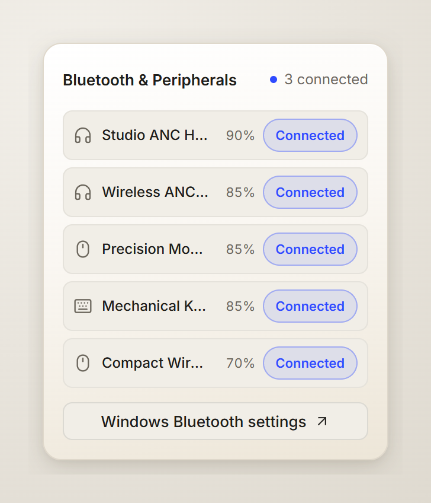 | 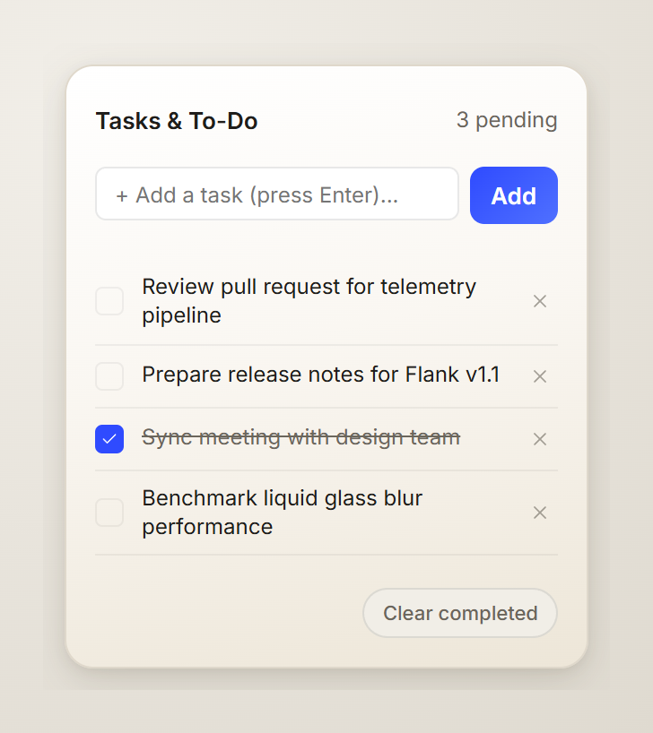 | 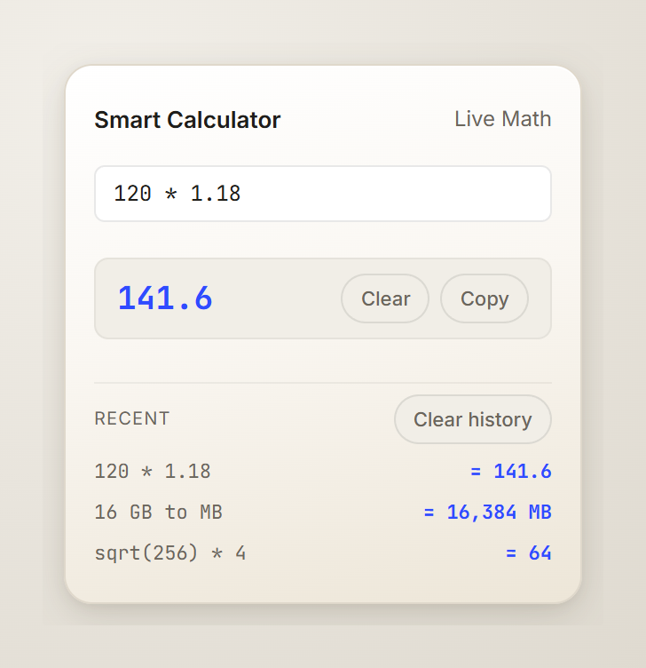 | 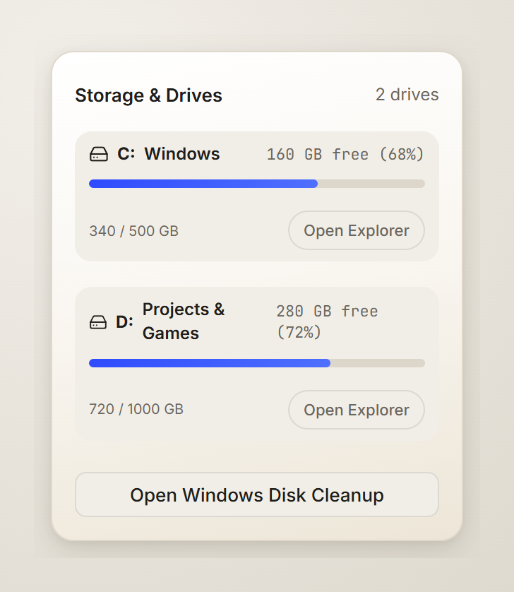 |

| Display & Brightness | Privacy Controls | Focus Ambiance | Command Runner |
| :---: | :---: | :---: | :---: |
| 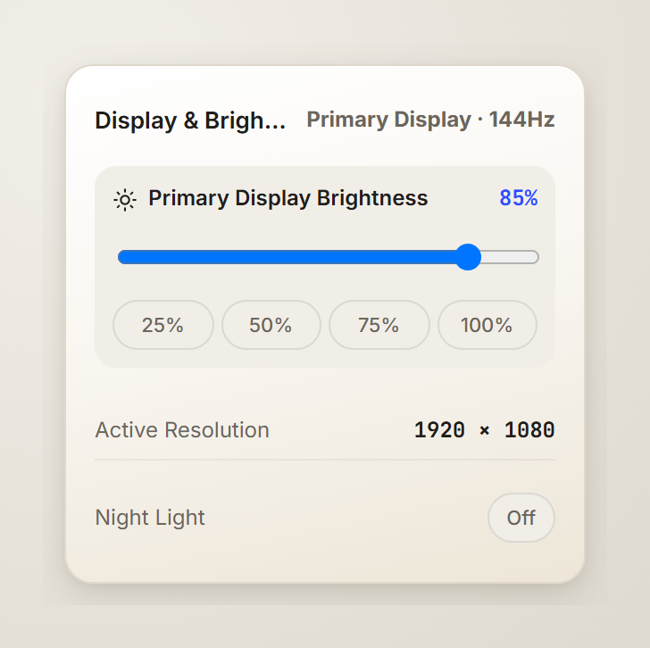 | 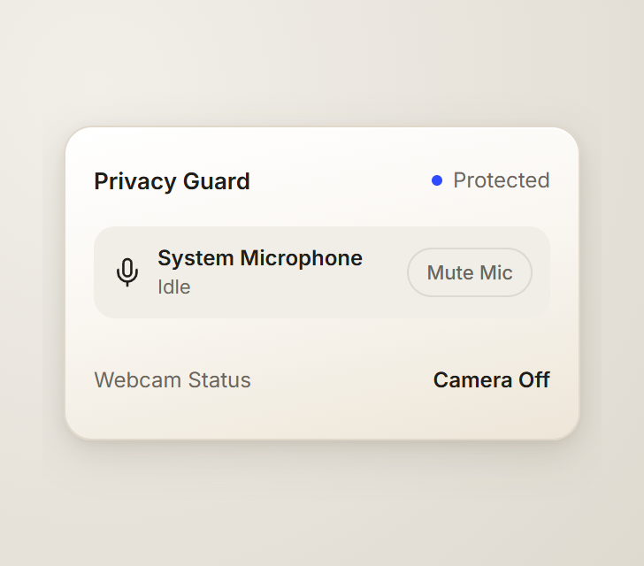 | 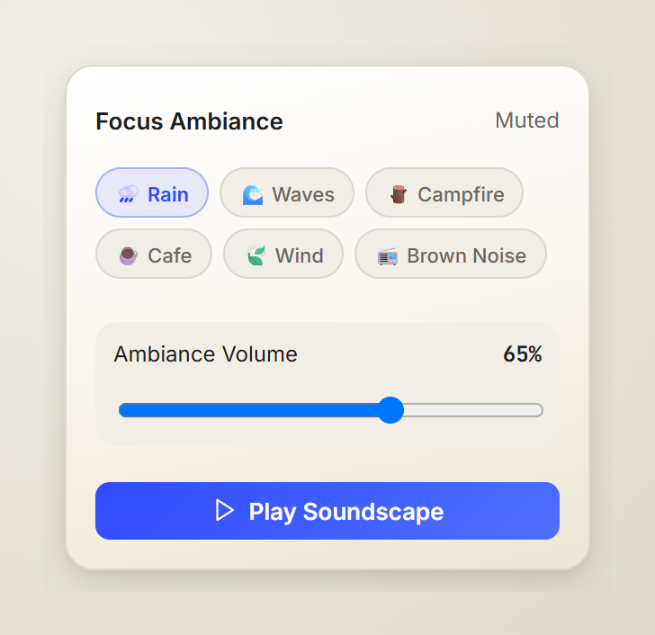 | 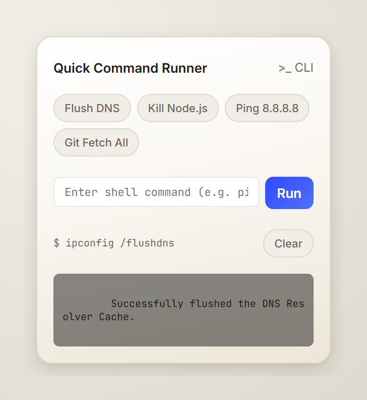 |

| GPU Telemetry | GitHub Activity | Active Widgets Drawer |
| :---: | :---: | :---: |
| 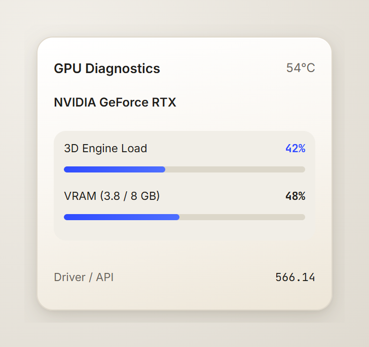 | 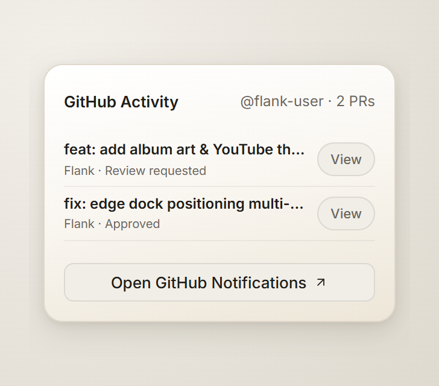 | 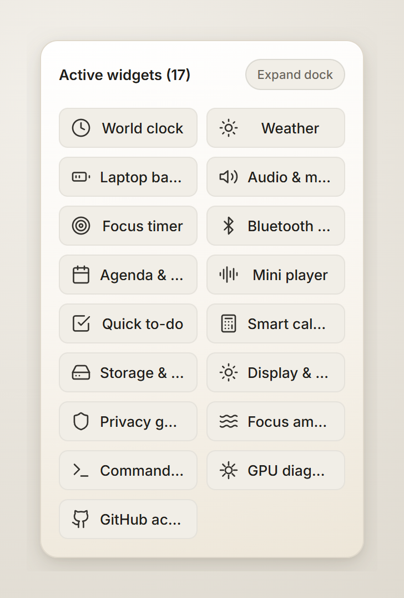 |

---

### 3. Dock Collapse & Edge Tab (`Ctrl+Alt+F`)

| Expanded Dock (Paper) | Expanded Dock (Liquid Glass) | Collapsed Edge Tab (Paper) | Collapsed Edge Tab (Liquid Glass) |
| :---: | :---: | :---: | :---: |
|  |  |  |  |

---

### 4. Settings, Themes & Clipboard Manager (`Ctrl+Alt+V`)

| Appearance & 7 Bundled Themes | Dock Items & Global Shortcuts |
| :---: | :---: |
|  |  |

| Clipboard History Window (`Ctrl+Alt+V`) | Widgets Configuration |
| :---: | :---: |
|  |  |

| About Flank (Paper Theme) | About Flank (Liquid Glass Theme) |
| :---: | :---: |
|  |  |

  

---

## Latest Updates

- **Calc (`calculator`)**: Renamed the dock tile label to **Calc** with an interactive expression history list, clear action, and a safe recursive-descent expression parser (`src/ui/calc.ts`).
- **Focus Ambiance (`ambient`)**: Upgraded **Café** synthesis to realistic multi-layered Web Audio coffee-shop acoustics (espresso steam hiss, ceramic clinks, and warm room murmur) alongside Rain, Fire, Forest, and Noise profiles (`src/ui/ambient.ts`).
- **World Clock & Telemetry Fixes**: Fixed clipped `Saved world clocks` header spacing and resolved `NaN MB` memory readouts in the **Top 30 Processes by Memory** view (`host/providers.py`).
- **Streamlined Widgets & Display Controls**: Removed the retired Habits and Hydration widgets and removed the Display Refresh Rate selector from **Display & Brightness**, keeping brightness control, presets, active resolution readout, and Night Light.
- **Security & Local Privacy Hardening**: Encrypted stored GitHub tokens using Windows **DPAPI** (`CryptProtectData` / `CryptUnprotectData`), scrubbed plaintext secrets from config storage, and kept all state, clipboard history, and telemetry 100% local with zero analytics or tracking.

---

## Live Widget Suite (22 Widgets)

Hovering any widget tile on the dock opens its live card without stealing keyboard focus (`SWP_NOACTIVATE`), or click the **Widgets** drawer tile to jump straight to any card:

| Category | Widgets |
| :--- | :--- |
| **Productivity & Focus** | **Clipboard** (`Ctrl+Alt+V`), **Tasks To-Do** (`tasks`), **Scratchpad Notes** (`scratchpad`), **Calc** (`calculator`), **Color Picker** (`colorpicker`), **Focus Timer** (`focus`), **Focus Ambiance** (`ambient`), **World Clock** (`clock`), **Agenda & Calendar** (`calendar`) |
| **Media & Developer** | **Media Player** (`player` with album art & YouTube thumbnail), **Command Runner** (`runner` with terminate button), **GitHub** (`github` PR & notification tracking) |
| **System & Hardware** | **Weather** (`weather`), **Audio & Mic Mixer** (`audio`), **System Telemetry** (`stats`), **GPU Telemetry** (`gpu`), **Battery & Devices** (`battery`), **Storage Drives** (`storage`), **Network Monitor** (`network`), **Bluetooth** (`bluetooth`), **Display & Brightness** (`display`), **Privacy Controls** (`privacy`) |

---

## 7 Bundled Themes

| Theme | Style |
| :--- | :--- |
| **Paper** *(Default)* | Light, warm `#fbfaf7` surface with soft shadows and crisp editorial contrast |
| **Glass** | Translucent dark frosted acrylic |
| **Liquid Glass** | Specular frosted glass with rim sheen and adaptive backdrop tinting |
| **Aurora** | Deep night glass with vibrant aurora gradients |
| **Nord** | Cool arctic slate palette |
| **Terminal** | Monospace high-contrast console strip |
| **Rail** | Compact ultra-thin spine layout |

---

## Installation & Keyboard Shortcuts

- **Download**: Grab the latest `Flank-Setup.exe` from [Releases](https://github.com/nandhakrishnasr/Flank/releases).
- **Windows SmartScreen**: If Windows Defender SmartScreen displays *"Windows protected your PC"*, choose **More info → Run anyway** (the open-source build runs entirely locally on your PC).
- **Default Shortcuts**:
  - `Ctrl+Alt+F` — Show / collapse Flank to the screen-edge tab
  - `Ctrl+Alt+V` — Open the full Clipboard History manager (`960×680`)
  - Configurable global & widget hotkeys (`Alt+1`–`Alt+4`, `Alt+C`, `Alt+W`, `Alt+S`, etc.) inside **Settings → Items**
